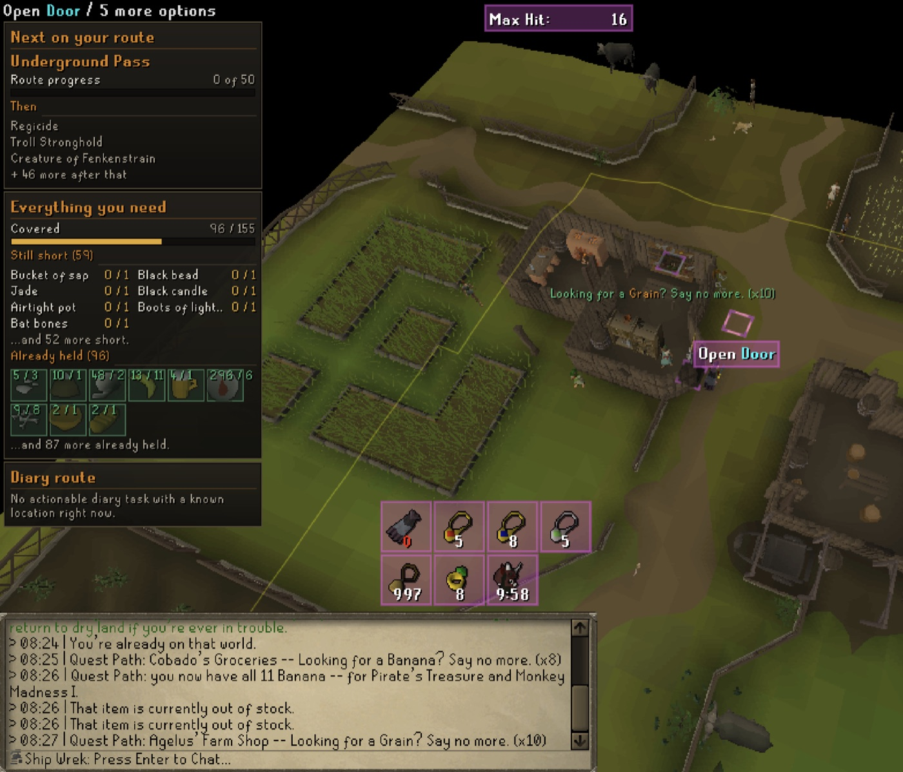
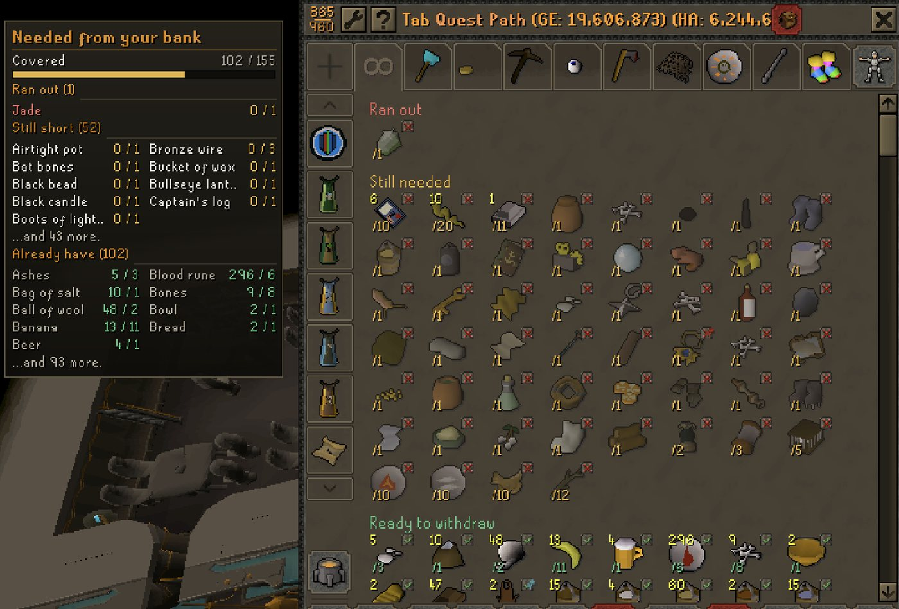
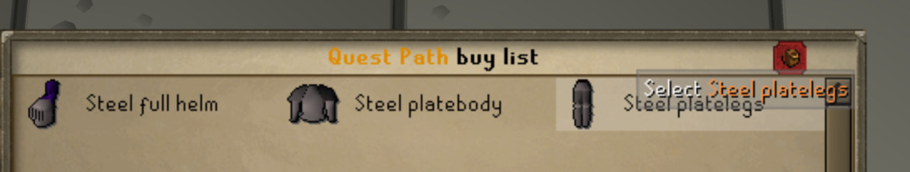
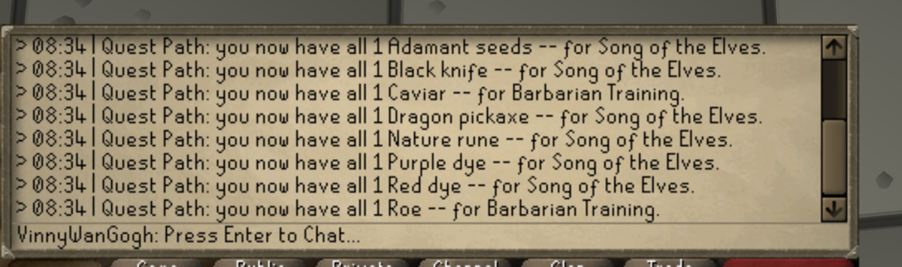
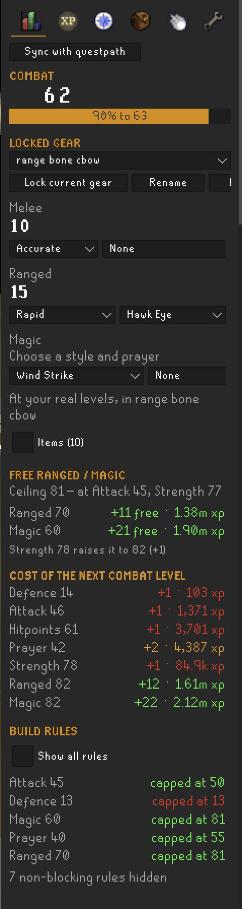
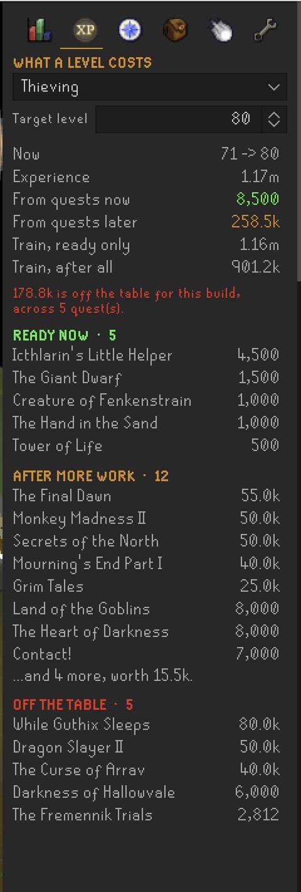
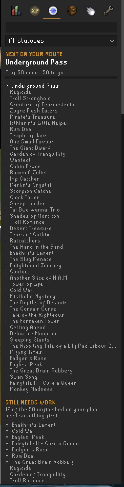
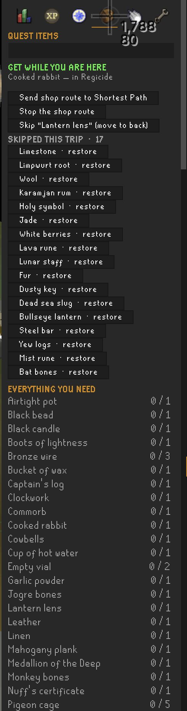
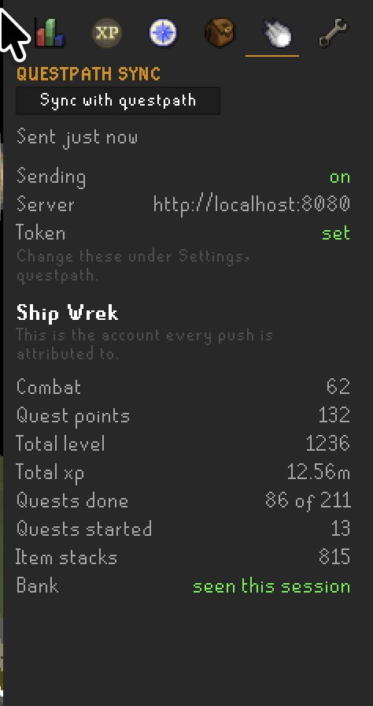
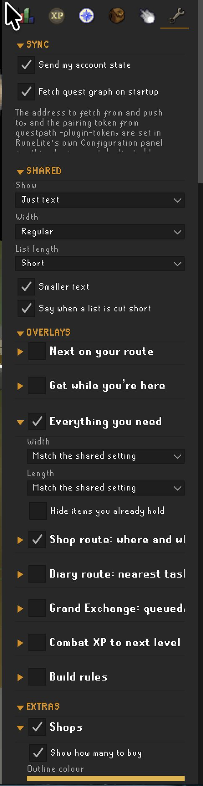

# questpath for RuneLite

**The plan, inside the game.** One shop run for every quest item, shopkeepers
calling out when you pass something you need, the next quest opening in Quest
Helper as you arrive, and a warning before a build rule ends the account.

> **Early development.** Most overlays are opt-in, and features marked
> *(in progress)* are partly built or next up.



Walking past **Agelus' Farm Shop**. It calls out "Looking for a Grain? Say no
more. (x10)" over the shop, and the same line lands in chat.

---

## Why it exists

Most quest tools check whether you *meet* a quest's requirements. This one also
checks whether the quest, or anything it depends on, would push a skill past a
cap you're holding on purpose — the question a pure or a restricted account
actually has.

For an ironman it removes the chore around every quest: gathering. Instead of a
side quest before the quest, you get one list for your whole plan, one trip to
collect it, and a shout when you walk past something on it.

**It works without a server.** The plugin ships its own copy of the quest graph
and a Java port of the [questpath](https://github.com/VinnyVanGogh) planner,
tested against the same 218 quest verdicts as the website. Your route, build
rules and diaries arrive when you sync.

---

## The shop run

1. **One list for the whole plan.** One total per item across every quest on
   your route, counted against bank, inventory and what you're wearing.
2. **Send it to Shortest Path.** One button builds the trip, nearest stop first,
   with items sold in the same place grouped together. Shortest Path draws the
   path and tells you where to teleport.
3. **Only places you can get to.** Guilds and quest-locked towns you can't enter
   are skipped. If no shop you can reach sells an item, the route sends you to a
   monster that drops it.
4. **Shopkeepers shout as you pass.** Come within 16 tiles of a shop stocking
   something you still need and it calls out, even if it isn't your next stop.
5. **The trip moves itself on.** When the last one lands in your bags, the route
   jumps to the next stop and chat says where. Skip an item and it goes to the
   back, with a restore button.


Shortest Path draws the line and marks the **Lumbridge Home Teleport**. The
overlay's next stop here is a monster drop — a Lantern lens from a Wall beast —
and the Items tab holds the trip's buttons and the 17 items skipped this trip.

---

## Items, wherever you're standing

**Shops.** Stock your quests still need is outlined, with how many to buy above
each slot. Hover to see which quest wants it.


**Bank.** A Quest Path button in the bank title bar turns the bank into a quest
tab: Ran out, Still needed, Ready to withdraw. Everything stays withdrawable,
and the "Needed from your bank" overlay sits beside it.



**Ground.** Needed items lying within 15 tiles are outlined with how many you
still need and which quests want them, and left-clicking picks them up before
the tile's other items.


**On the go.** "Get while you're here" lists items you can pick up during your
next few route quests that another quest also needs. Finish collecting one and a
note can float up over the shopkeeper.

**Grand Exchange.** For mains, and hidden automatically on every ironman
account. The GE item search grows a buy-list button, and the list opens in place
of the search results, so the next thing to buy is one click rather than a name
you have to remember.



An overlay follows the whole trip while the offers run: what's next, what's
queued, what's still left, and what the GE can't sell you at all. Progress counts
against what you *need* rather than the size of the offer, so ten of something a
quest wants one of reads "10 of 1" instead of a tidy "10 of 10" that would hide
nine items sitting in the collection box.


**Recommended items, if you want them.** Every quest page also lists what the
wiki *recommends* bringing — Camelot teleports, antipoison, a few hundred coins
— and on a main those are things you buy rather than walk for. One toggle
(off by default, in the Items tab and in Settings) adds them to the Grand
Exchange list and the shop route, in their own section after the required
items so the required list never changes. A recommended teleport can be
listed as the tablet or as the runes to cast it (Camelot: 5 air, 1 law), your
choice; runes are only offered when your Magic level can cast the spell.
Recommended coins are never a buy line — they show as a balance to bring.
This needs a quest graph that carries recommended items (version 13); on an
older graph the panel says so rather than showing an empty section.

Collect, and every item the trip has now fully covered says so in chat, naming
the quest that wanted it.



---

## The sidebar

| Tab | What it holds |
|---|---|
| **Combat** | Combat level and progress, locked gear with live max hits, the free Ranged/Magic ceiling, what the next combat level costs per stat in exact XP, and your build rules |
| **Skills** | What a level costs: XP from quests now, later, or never on this build, and what's left to train |
| **Quests** | Next on your route with progress, your whole route in order, "Still needs work", "Start, never finish", and every quest's verdict, searchable |
| **Items** | Get while you're here, the shop route buttons, skipped items, and everything you need counted against what you hold |
| **Sync** | Whether the last push went out, the account it's attributed to, and what was sent |
| **Group** | Party members and their quest counts, quests you can do together next, quests that break a member's build, per-quest item split with hand-overs, party-wide group shopping, and quests done by only some of the group |
| **View** | Every setting, grouped and readable, instead of a 225px config column |

<details>
<summary>Screenshots of each tab</summary>

**Combat**



**Skills**



**Quests**



**Items**



**Sync**



**View**



</details>

---

## Quests, diaries and combat

- **Next on your route.** An overlay you can leave on: the next quest, a
  progress bar, and a preview of what's after it.
- **Start in Quest Helper.** Right-click any quest to start it there. If Quest
  Helper isn't installed, isn't on, or doesn't know the quest, the menu entry
  says why instead of doing nothing.
- **Opens as you arrive.** Walk within 8 tiles of a route quest's start point
  (205 of 218 quests have one) and Quest Helper opens for it. Finish a route
  quest and the next can start by itself.
- **Stays out of your shop run.** Quest Helper's automatic starts are held back
  while a shop trip is active, so they don't overwrite your path.
- **Diary route.** The nearest diary tasks you can actually do, sent to Shortest
  Path like the shop run, with a chat nudge when one is within 12 tiles, a
  searchable diary journal on the Quests tab, and a Quests / Diaries / All
  filter that drives both the panel and the route overlays.
- **Combat maths.** What each stat would cost to buy the next combat level, in
  real XP, cheapest first — on a pure, one Strength level is a week of work and
  one Defence level can end the build.
- **Locked gear.** Save a loadout and see its melee, ranged and magic max hit at
  your live levels, with style, prayer, spell, melee strength potion, the next
  level that raises each max hit, and what prayer and potion each contribute.
- **Build rules.** How much room is left before a rule breaks, editable per
  account in the sidebar and merged over synced rules. No-XP and hard caps
  escalate as you close in; soft caps and goals never do.
- **Lamp advisor.** When an experience lamp or tome opens, blocked skills are
  greyed out, the top three targets are boxed, and hovering any skill explains
  why.

---

## Syncing with questpath

Off by default. With sync on, the plugin pushes your quests, levels, XP, bank,
inventory and equipment to a [questpath](https://github.com/VinnyVanGogh)
instance you host, so it stops polling third-party services for data your own
client already has.

- The pairing token both authenticates the push and names the account it writes
  to. Get it with `go run ./cmd/questpath -plugin-token` on the server.
  *(Issuing it from the settings page: in progress.)*
- Every push returns your build rules, constraints, route order, partial runs,
  owned items and diary tasks.
- The Sync tab says whether the last push was accepted, refused or never
  answered. A wrong token says so rather than failing quietly.
- On startup the plugin can fetch a fresher quest graph from the server, and
  says which one it ended up on.
- A "Sync with questpath" button pulls a plan you just edited on the site
  straight into the game.

What ships in the bundle: 314 shops, 125 monster drop locations, 205 quest start
points, and 492 diary tasks with 376 of them placed on the map.

---

## Questing as a group

For Group Ironman teams, or anyone questing together in a RuneLite party. It
uses RuneLite's own Party service only: no questpath server, no third party,
no uploads.

- **Off by default.** Turn on "Share with my party" (View tab → Sync, or the
  "Group (party)" config section). While it is off this client sends nothing.
  Turning it off sends one "forget me" message that carries no account data.
- **What is shared:** finished and started quests, levels, experience, your
  build rules, your active route, your account type, counts of items that some
  quest asks for, and (for Group Ironmen, once opened) quest items in Group
  Ironman storage, refreshed on a 5-minute heartbeat. Never the rest of your
  bank, and never another player's data. You only see what other members chose
  to send.
- **The Group tab** lists each member and how many quests they've done, then:
  - **Do together next:** quests nobody has done that every member can start
    now.
  - **Breaks someone's build:** quests everyone could start, except that they
    would give a capped member XP they don't want, or need a level above that
    member's cap. For example, "Bob: 18,650 Defence xp (capped at 1)". It uses
    the same build-rule check as the Quests tab.
  - **Who brings what:** pick a group quest. Each member needs their own copy
    of every item, so spares get handed over before anything is bought. Members
    who shared no item counts show as unknown, not as owning nothing. Group
    storage is not counted here; Group shopping below counts it.
  - **Group shopping:** what the whole party still has to get across each
    member's active route (or every unfinished quest their build allows when
    they have none), spending each member's own holding first, then tradeable
    spares between members who can trade, then Group Ironman storage once from
    the freshest snapshot. Lists where you can get each remaining item (Grand
    Exchange for normal accounts, reachable shops and monster drops for
    ironmen), filters by quest, member, or still-needed items, and sends the
    group's reachable shops to Shortest Path. An optional "Group needs in shop
    alerts" toggle (off by default) adds the party's remaining needs to the
    near-shop chat call-out once per visit.
  - **Done by some of you:** who has finished a quest and who still needs it.
- Party members on a Quest Path version that sends a different message shape
  are listed as "other version". They are never shown as having done nothing.

---

## Building

```bash
./gradlew build          # compile and test
./gradlew run            # launch a developer client with the plugin loaded
```

The build targets Java 11 bytecode. To log in to the development client, follow
[Using Jagex Accounts](https://github.com/runelite/runelite/wiki/Using-Jagex-Accounts).

The planner here is a port of the Go one, and the two must agree:
`PlannerVectorsTest` checks all 218 verdicts against vectors exported from the
server. When it goes red, the answer is to close the gap — never to re-export
the vectors, which writes the bug down as the expected result.

---

## Licence

BSD 2-Clause. See [LICENSE](LICENSE).
