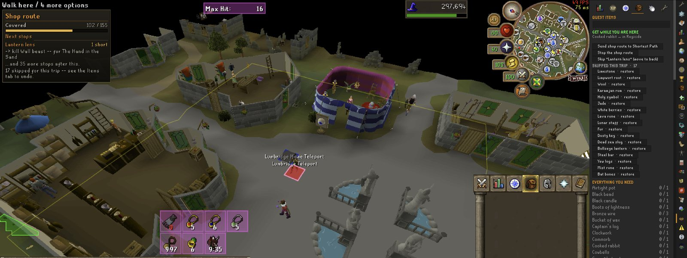
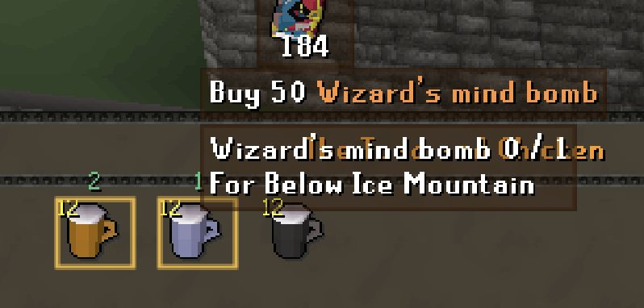
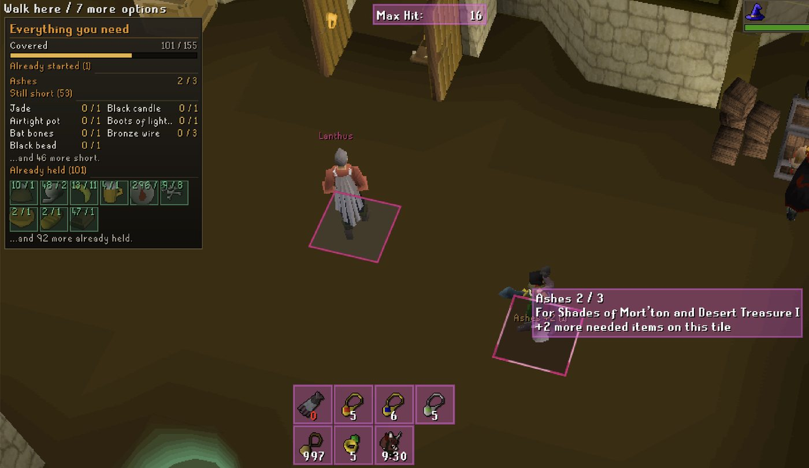
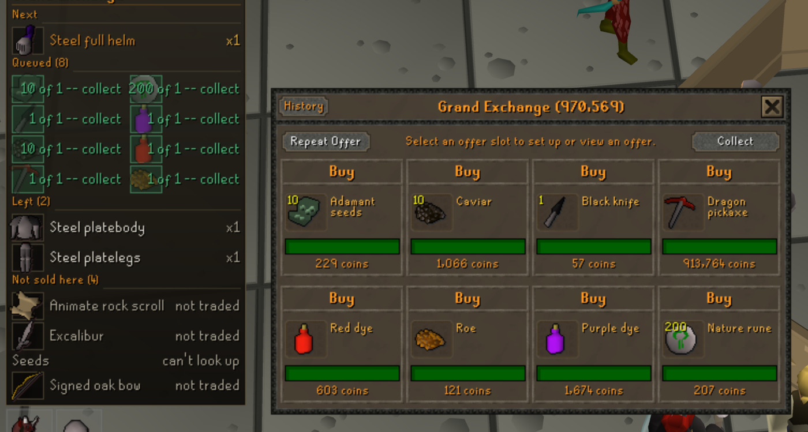

# Quest Route

Quest planning, item routing, combat XP maths, and build-rule guards for Old
School RuneScape accounts inside RuneLite.

Most quest tools check whether you *meet* a quest's requirements. Quest Route
also checks whether the quest—or anything in its prerequisite chain—would push
a skill past a cap you hold on purpose, then turns the items across your route
into one trip.

> **Name.** This plugin was called *questpath* during development. Another
> author's *QuestPath* is on the Plugin Hub, so this plugin ships as **Quest
> Route**.

---

## Features

- **No server needed.** Ships a bundled quest graph (218 quests, 314 shops, 125
  monster drop locations, 492 diary tasks, 300 boosts) and lamp catalogue (20
  lamps and tomes), checked against the same 218 quest verdicts as the
  companion planner. Everything saves in RuneLite's own per-account config; no
  external files are written.
- **Account setup & build presets.** First run opens **Account setup** on the
  **Quests** tab (reachable any time from the **Account setup** button at the
  top of the sidebar): pick your account type, free-to-play and/or members
  quests, and one of **27 named builds** (F2P and Members 1 Defence pures,
  Zerker, Void, Initiate, Obsidian builds, Defence tank, *Skiller (no combat
  XP)*, and more) or custom per-skill limits (*No limit*, *No XP ever*, *Stop
  at level*, *Warn only*, *Goal level*).
- **Your route & quest verdicts.** Builds a prerequisite-ordered route leaving
  out quests your build or levels forbid, lists **Still needs work** with full
  blocker and boost chains on hover, and groups all 218 quests by verdict.
  Right-click any quest to **Pin to the front of the route**, **Do it later**,
  or **Refuse: never do this quest**, or tick **Hide quests your build has
  closed off**.

### The shop run

1. **One list across your plan.** Totals every item across your doable or
   routed quests against your bank, inventory, worn gear, and (for Group
   Ironmen, once opened) Group Ironman storage. Any-tier requirements (*any
   pickaxe*, *any axe*, nails, logs, bars, light sources) fill from whichever
   qualifying tier you already own.
2. **Send to Shortest Path.** Orders reachable stops nearest-first from where
   you stand, groups items sold at the same shop, and sends the target set to
   **Shortest Path** over `PluginMessage`.
3. **Only places you can use.** Skips locked guilds, quest-gated towns,
   Wilderness stops you forbid, and Thieving stalls above your level. Falls
   back to practical monster drops when no reachable shop stocks an item—never
   a boss or a Slayer/combat-locked monster.
4. **Spoken & overhead call-outs.** Walk within 16 tiles of a reachable shop
   selling something you still need and Quest Route calls out the items using
   bundled offline voice clips (with **Say again** on the active stop), even
   when you were not routed there.
5. **Auto-advance & skip.** Completing an item advances the trip to the next
   stop; **Skip** moves an awkward stop to the back with one-click **restore**.

### Items in the world, shops, bank & Grand Exchange

- **Drop sources.** Outlines NPCs and world objects in view (such as Imps for
  beads or berry bushes) when drops lead an item's sources, labelled `drops
  <Item>`, and stops outlining as soon as you hold enough.
- **Shops.** Outlines needed stock while a shop is open, prints how many to buy
  in green above the slot, and names the quest on hover.

  

- **Bank.** A backpack button in the bank title bar (stepping aside cleanly for
  other plugins, and toggling back out on **Hide tab** or any bank tab click)
  groups your bank into *Ran out*, *Still needed*, *Ready to withdraw*, and
  *Everything else* while keeping every owned stack withdrawable, alongside the
  *Needed from your bank* list.
- **Ground items.** Outlines needed items within 15 tiles with counts and quest
  tooltips, draws a bouncing arrow and speaks `"<Item> nearby"` once per spawn
  within *Floor-item range (tiles)*, and promotes **Take** to left-click on
  needed items only.

  

- **Grand Exchange.** Shown on main accounts and hidden on every ironman. Adds
  a buy-list button inside GE item search (selecting items by ID without ever
  typing into the chatbox) and a live **Grand Exchange: queued, next, left**
  overlay while the GE window is open.

  

### Combat, locked gear & experience lamps

- **Combat level cost & ceiling.** Exact XP and levels required in each combat
  stat to reach the next combat level (cheapest first), plus how many Ranged
  and Magic levels remain free at your current Attack and Strength.
- **Locked gear.** Save named worn-gear loadouts per account and inspect live
  Melee, Ranged, and Magic max hits as your levels move—with attack style,
  prayer, spell, melee strength potion, next-level max-hit breakpoints, and
  *Without prayer* / *Without potion* comparisons.
- **Experience lamps.** Washes skills closed by your build rules in grey, tints
  risky soft-cap skills in amber, boxes your top safe choices, and explains
  every verdict on hover.

### Group questing (RuneLite Party)

For Group Ironman teams or friends questing in a RuneLite party, over
RuneLite's built-in Party service only (*Share with my party*, off by default):

- **Do together next** and **Done by some of you** across sharing party
  members (`GIM1`, `GIM2`, ...).
- **Breaks someone's build:** flags quests everyone meets requirements for that
  would breach a teammate's cap or no-XP rule (e.g. `GIM2: 18,650 Defence xp
  (capped at 1)`).
- **Who brings what & Group shopping:** per-quest item splits with spare
  hand-overs (`GIM1 gives GIM2 3`), party-wide shopping totals counting own
  holdings, tradeable spares, and the freshest Group Ironman storage snapshot,
  plus **Shortest Path** routing to group shops and optional near-shop group
  alerts.

---

## Sidebar

Above the tab strip on every page: **Account setup**, **What's new** (replays
update notes in chat), and a foldable **Quick settings** block for the eight
most-used toggles with an **All settings ↓** link to the **View** tab.

| Tab | What it holds |
|---|---|
| **Combat** | *Sync with Quest Route*, combat level & progress, *Locked gear* max hits, *Free Ranged / Magic* ceiling, *Cost of the next combat level*, and *Build rules* (with *Show all rules* and the per-account rules editor) |
| **Skills** | *What a level costs*: XP needed to a target level, *From quests now* (*Ready now*), *From quests later* (*After more work*), training remainder, and XP *Off the table* for your build |
| **Quests** | *Quests / Diaries / All* filter, search & status filter, *Hide quests your build has closed off*, *Next on your route*, *Still needs work*, *Start, never finish*, right-click quest marks (*Pin*, *Do it later*, *Refuse*), *Can I do this quest?*, *Diary route*, and *Diary journal* |
| **Items** | Search, *Get while you are here*, *Grand Exchange list* (mains), shop route buttons (*Send*, *Stop*, *Skip*, *Say again*, *Skipped this trip*), *Everything you need*, and *By quest* |
| **Sync** | Status of optional self-hosted server sync, configured address/token state, attributed character snapshot, and unmatched quest names |
| **Group** | *Your group*, *Do together next*, *Breaks someone's build*, *Who brings what*, *Group shopping*, and *Done by some of you* |
| **View** | Collapsible sidebar controls for *Sync*, *Shared*, *Overlays*, and *Extras*, kept in two-way sync with RuneLite's configuration panel |

---

## Quick start

1. Enable **Quest Route** and click the quest-scroll icon in RuneLite's
   sidebar.
2. On the **Quests** tab, pick your **Account type**, **Quests to route**, and
   a **Build** preset (or custom **Skill limits**), then click **Save and show
   my route**.
3. Open your bank once in game so item totals include what you already own
   (Group Ironmen: open Group Storage once as well).
4. Open **Quick settings** at the top of the sidebar (or the **View** tab) to
   toggle in-game overlays, spoken prompts, bank tab layout, or party sharing.

**Every setting, optional self-hosted sync, friend testing, limitations, and
building from source: [SETUP.md](SETUP.md).**

---

## Privacy & network

By default Quest Route makes **no network connections**: planning, overlays,
and voice clips run locally from bundled resources and RuneLite config.

- **Party sharing** (*Share with my party*, off by default) uses RuneLite's own
  Party service only and shares quest states, levels, XP, build rules, route,
  account type, and quest-item counts with your current RuneLite party.
- **Self-hosted sync** (*Send my account state*, off by default) carries
  RuneLite's third-party server IP warning and sends account state only when
  you turn it on and configure a *Quest Route address* and *Pairing token*.

---

## Licence

BSD 2-Clause. See [LICENSE](LICENSE).
